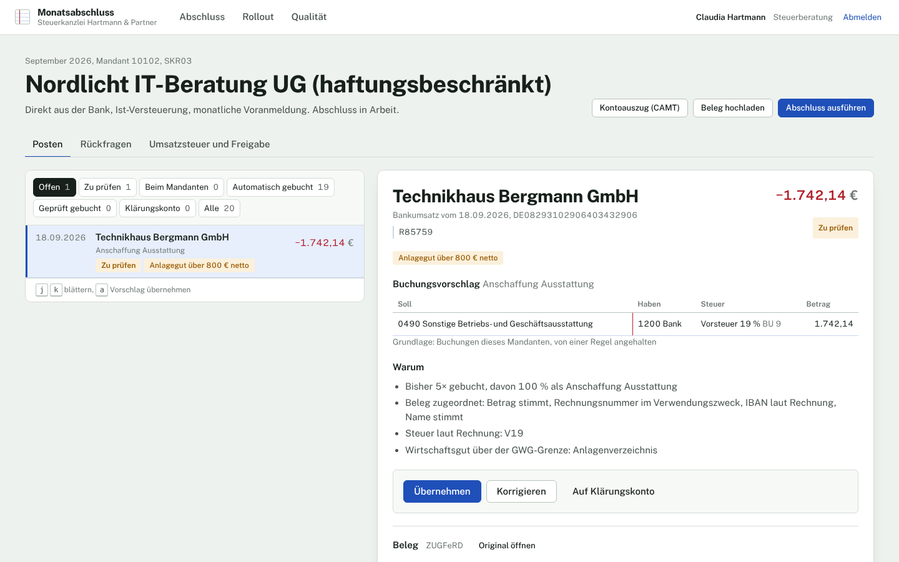
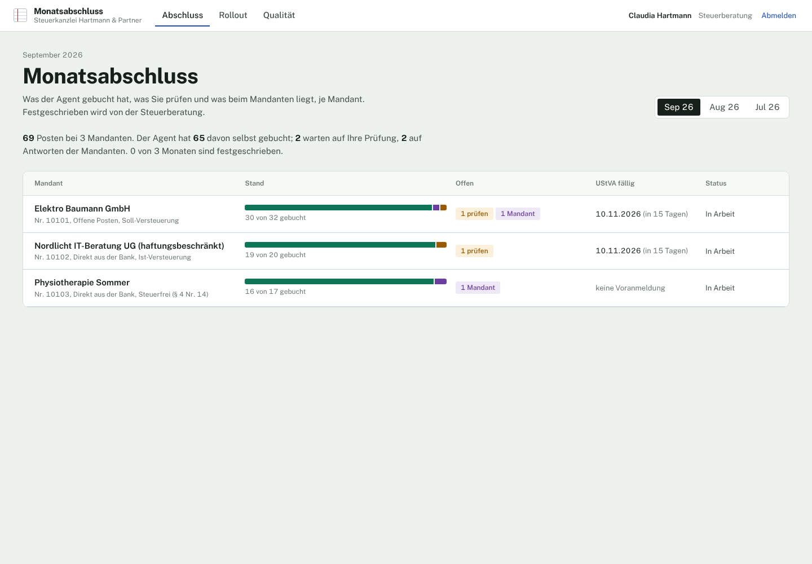
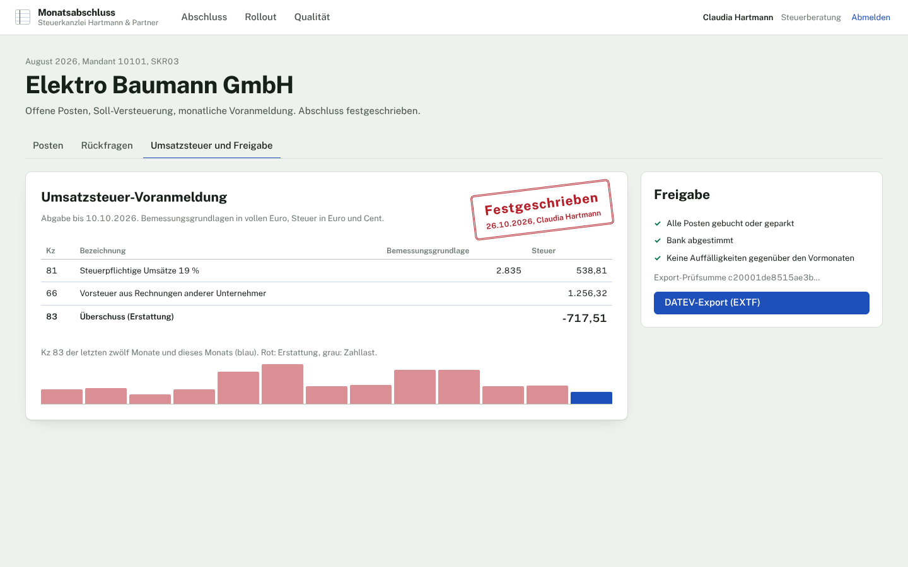
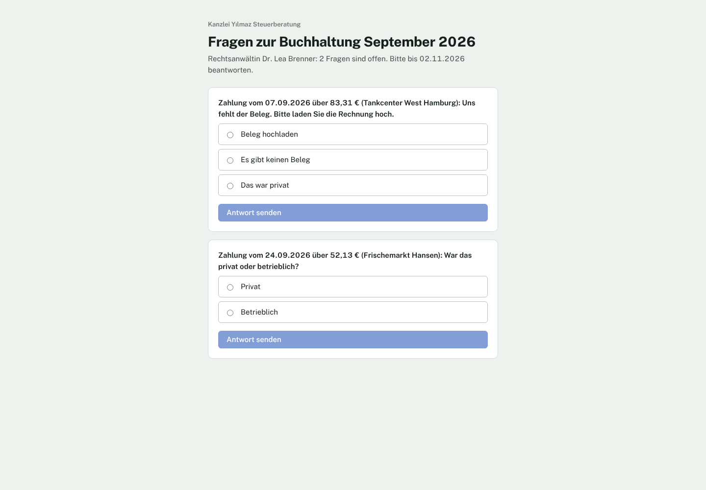
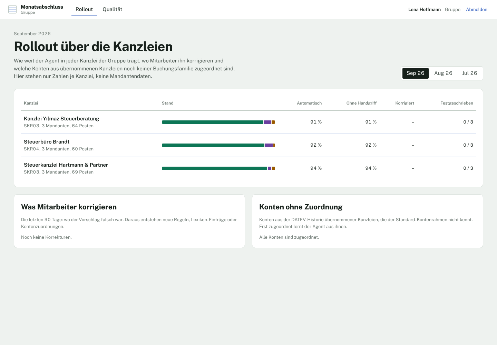
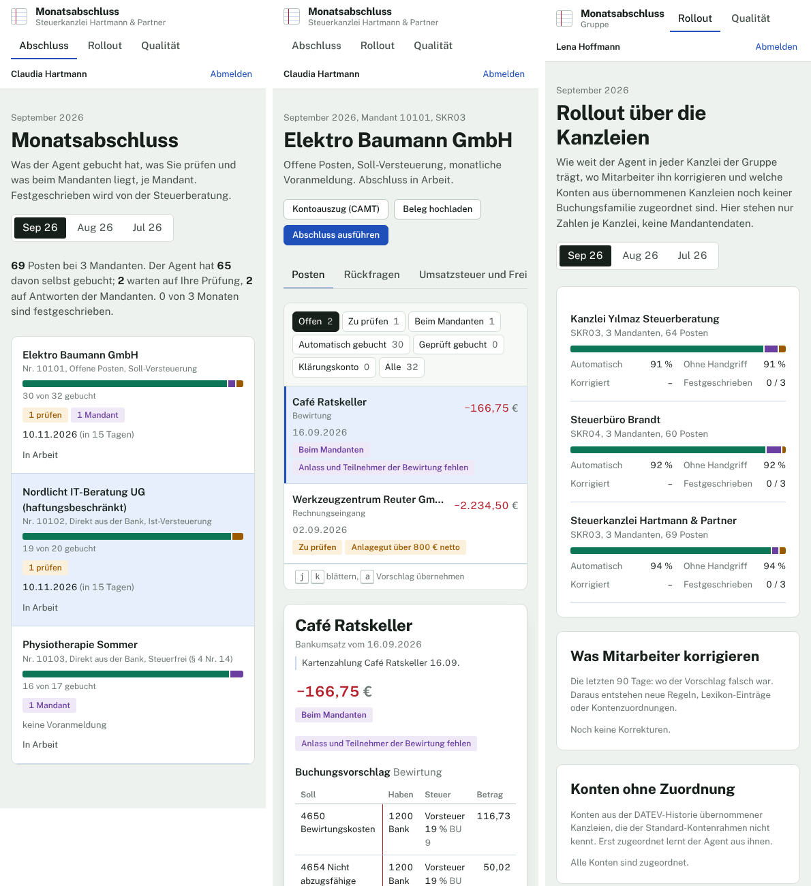

# kanzlei-close-agent

The monthly close for a German tax firm's clients, run by an agent and signed off by the advisor.

Bank statements (CAMT.053) and invoices (XRechnung UBL and CII, ZUGFeRD, PDF) come in. The agent
matches payments to invoices and open items, proposes each booking in SKR03 or SKR04 with its reasons,
asks the client only what is missing through a portal without an account, and leaves the rest for
review. The advisor sees the VAT return (UStVA Kennzahlen) against the last twelve months, signs the
month off, and the bookings are locked (GoBD Festschreibung) and exported to DATEV as an EXTF
Buchungsstapel. A group that buys tax firms onboards each one from its DATEV history and watches the
rollout per firm without seeing client data.



## Results

Measured end to end against an answer key: every month is closed in a fresh database with a simulated
client, reviewer and advisor, and every booking and every VAT Kennzahl is compared with the truth.
The blind sets were written by someone who never saw the code; a set's first run is recorded once and
never rewritten. Without a language model.

| | Development months | Blind v1, first run | Blind v2, first run | **Blind v3, first run** |
| --- | ---: | ---: | ---: | ---: |
| Items (payments and invoices) | 604 | 189 | 222 | **193** |
| Booked by the agent alone | 89.2 % | 52.9 % | 42.8 % | **39.4 %** |
| … of which wrong | 0 | 5 | 0 | **0** |
| Booked after a client's answer, nobody looked: wrong | 0 | n/a | 5 of 23 | **0 of 5** |
| No staff action (agent or client answer) | 93.7 % | 60.3 % | 53.2 % | **42.0 %** |
| First proposal right | 98.2 % | 75.1 % | 83.8 % | **82.9 %** |
| Final bookings matching the answer key | 100 % | 93.1 % | 97.6 % | **100 %** |
| Questions to clients that were needed | 96.6 % | 33.3 % | 98.2 % | **100 %** |
| VAT return exact to the cent | 27 / 27 | 2 / 5 | 6 / 6 | **5 / 5** |
| Months signed off | 27 / 27 | 4 / 5 | 6 / 6 | **5 / 5** |

On firms it has never seen, the agent books less on its own instead of booking wrongly: the threshold
is set on a bound (at most 1 % wrong at 95 % confidence, [ADR 4](docs/adr/0004-when-the-agent-books-alone.md))
and rules stop anything risky. Each blind set found something, and each was studied only after its
first run was recorded:

- **v1** found tax gaps: reverse charge for foreign services invoiced without a rate, an EU sale without
  the customer's VAT id, and double bookings when a client answered twice. Fixed; v1 became a
  regression set.
- **v2** had no wrong automatic booking and every VAT return exact, but 5 of 23 items booked after a
  client's answer had the wrong expense family: the answer brought a receipt, and the engine treated
  that as settling what the payment was. Now an answer decides only the question asked, and the
  evaluation and release gate count every booking nobody looked at. v2 became a regression set.
- **v3**, written after that fix, ran once: nothing booked without staff was wrong, every final booking
  matches the answer key, every question asked was needed, every VAT return exact.

Today all three blind sets and the development months run at 0 wrong bookings without staff and 100 %
final bookings right. Staff minutes are an estimate from `config/close.yaml` (145 against 483 by hand
for v3), not a measurement.

`reports/evaluation.json` has every number for today's code; `reports/blind/*/FIRST_RUN.json` the first runs, as recorded.

## What it does

| | |
| --- | --- |
| **Read** | CAMT.053 with balance check; XRechnung (UBL, CII) and ZUGFeRD exactly; PDFs by layout, optionally by a model whose lines must add up. XML bombs are refused. |
| **Match** | Payments to invoices and open items, several invoices in one transfer, cash discount (Skonto) lines, partial payments, standing contracts. |
| **Propose** | Family from the client's own history (by IBAN and name), a text classifier, or the invoice; tax code by rules (§ 13b, intra-community, Kleinunternehmer, § 4 Nr. 14, meals 70 %, GWG, Pflichtangaben); account from the chart. Each proposal says why. |
| **Decide** | Book alone only above a threshold with a bounded error rate, and never when a rule objects. |
| **Ask** | One bundle per client and month with fixed answers: missing receipt, private or business, meal details, a corrected invoice. Answers are booked by the same rules. |
| **Review** | A queue per firm with keyboard shortcuts, corrections that the agent learns from, a Klärungskonto for what stays open. |
| **Sign off** | VAT return in form order with a plausibility check against the last twelve months, bank reconciliation, open items; Festschreibung; EXTF export with checksum. |
| **Onboard** | A firm's DATEV EXTF history and master data; unknown accounts mapped in the rollout view. |
| **Roll out** | Per firm: share booked alone, untouched, corrected, signed off; what staff correct most. No client data (enforced by Postgres). |

| | |
| --- | --- |
|  |  |
|  |  |

The screens on a phone: 

## Architecture

```
          CAMT.053, XRechnung, ZUGFeRD, PDF                     DATEV EXTF history (onboarding)
                         │                                                   │
                ┌────────▼─────────┐   family    ┌──────────────┐   ┌────────▼────────┐
                │ formats/ (read)  ├────────────►│ engine/      │◄──┤ client memory   │
                └──────────────────┘   + reasons │  propose     │   │ classifier      │
                                                 │  decide      │   │ (model, opt.)   │
                    domain/tax.py ──tax code────►│  ask, review │   └─────────────────┘
                    charts/*.yaml ──account─────►│  sign off    │
                                                 └──────┬───────┘
                       Postgres 16: row-level security, │ triggers lock signed months,
                       hash-chained append-only events  │ portal via security-definer functions
                                                 ┌──────▼───────┐
               staff (OIDC at the load balancer) │ FastAPI      │ client portal (token link)
                                                 └──────┬───────┘
                                                 React 19 + Vite
```

- `backend/src/kanzlei`: the product. `formats/` (CAMT, UBL, CII, ZUGFeRD, PDF, EXTF), `domain/` (money,
  tax rules, VAT return, charts), `engine/` (matching, memory, classifier, decision, close), `api/`,
  `migrations/` (schema and rights), `cli.py` (migrate, onboard, worker, verify-audit).
- `backend/src/kanzlei_sim`: simulated firms, the independent truth, the runs, training and evaluation.
  The product never imports it (`tests/test_isolation.py`).
- `config/`: families, charts, tax, close thresholds, model use, release gate; the trained weights.
- `web/`: feature-first React app; `deploy/terraform`: AWS Frankfurt; `docs/adr`: the decisions.

## Run it

Docker:

```bash
docker compose up -d --build
docker compose --profile demo run --rm seed      # prints the client portal links
open http://localhost:8080                       # pick a person; portal links work without one
```

Without Docker (Python 3.12+, Node 22, Postgres 16 on localhost with postgres/postgres):

```bash
cd backend && python -m venv .venv && . .venv/bin/activate && pip install -e ".[dev]"
python -m kanzlei_sim seed --reset --links .demo-links.json
KANZLEI_DEMO_MODE=true uvicorn kanzlei.api.app:create_app --factory --port 8000
cd ../web && npm ci && npm run dev                # http://localhost:5173
```

Tests and evaluation:

```bash
cd backend && ruff check src tests && mypy && pytest -q            # 68 tests, Postgres needed
cd web && npm run lint && npm run typecheck && npm test            # 46 component and flow tests
python -m kanzlei_sim evaluate --sets dev,v1,v2,v3 && python -m kanzlei_sim gate
cd web && E2E_LINKS=../backend/.demo-links.json npx playwright test   # desktop and phone
python -m kanzlei_sim train                                         # classifier and decision model
```

CI runs all of it: backend, web, evaluation with the release gate and a check that no first run
changed, Playwright on the seeded stack, `terraform validate`, and the container images with a smoke
test.

## Deploy

`deploy/terraform` builds the production setup in `eu-central-1`: VPC with private subnets, RDS
Postgres 16 (encrypted, Multi-AZ, TLS forced, 35 days of backups), S3 for documents with Object Lock in
compliance mode for 8 years and KMS, ECR, Secrets Manager, ECS Fargate (API, outbox worker, web) with
Service Connect, and an ALB with TLS 1.3 and OIDC in front of staff pages only. Migrations run as a
one-off task. See [ADR 3](docs/adr/0003-gobd.md) and [ADR 10](docs/adr/0010-sign-in.md).

## Settings

Everything a firm or the group would tune is in `config/`: thresholds in `close.yaml`, tax constants
and Kennzahlen in `tax.yaml`, charts in `charts/`, model use in `llm.yaml`, release limits in
`release.yaml`. Environment: `KANZLEI_DATABASE_URL`, `KANZLEI_ADMIN_DATABASE_URL`,
`KANZLEI_TOKEN_SECRET`, `KANZLEI_STORAGE_URL` (`file://` or `s3://`), `KANZLEI_ALB_ARN` (sign-in),
`KANZLEI_DEMO_MODE`, `KANZLEI_SMTP_*`, `ANTHROPIC_API_KEY` (optional).

## Limits

- The data is simulated. The simulation is detailed (DATEV history, all invoice formats, clients who
  answer late or not at all), but a real firm will have cases it does not, which is what the blind
  sets and the rollout view are for.
- Payroll, fixed-asset depreciation and the annual accounts are out of scope; payroll payments are
  booked, payroll itself comes from DATEV Lohn.
- The VAT return is computed and checked, not filed: ELSTER filing stays in DATEV.
- Accounts are SKR03 and SKR04 with the families in `config/families.yaml`; other charts need a
  mapping file.

Background and sources: [docs/RESEARCH.md](docs/RESEARCH.md).
